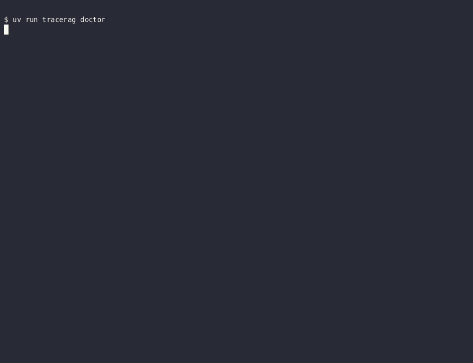
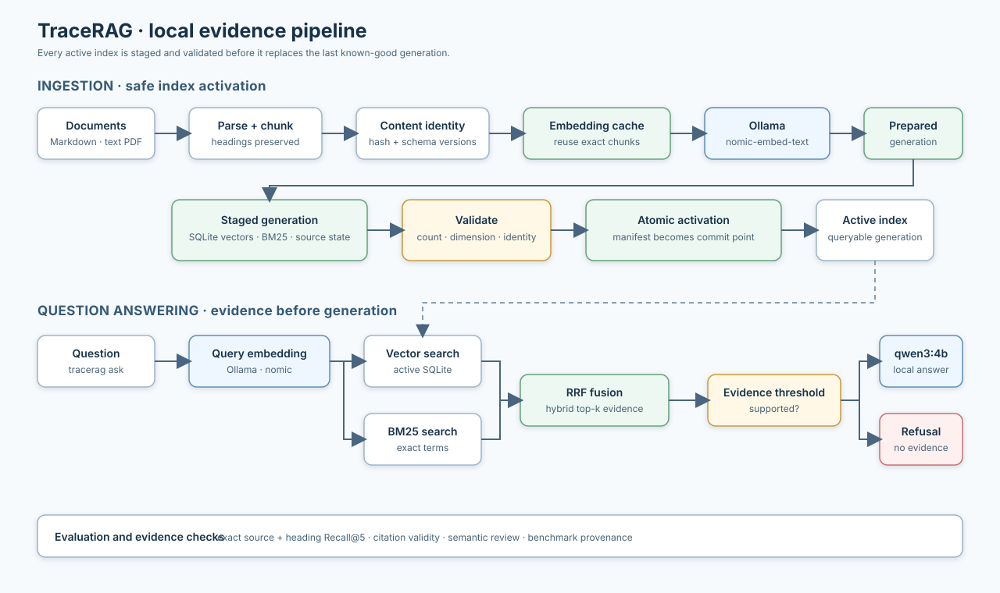

# TraceRAG

TraceRAG is a local-first, citation-first terminal RAG system with reproducible
evaluation and safe index activation.



TraceRAG v1.2 indexes
Markdown and text-layer PDFs, searches them with semantic and exact-term
retrieval, and answers only when it can show supporting evidence. The release
focuses on reliable incremental indexing, exact evidence targets, and measured
operator workflows on a compact Apple Silicon laptop.

## Why TraceRAG

Most small RAG demos stop at “retrieve a few chunks and ask a model.” TraceRAG
makes the trust boundary observable instead: every answer is tied to an exact
source and heading, unsupported questions are refused before generation, and
index updates are staged so a failed write cannot replace the last known-good
generation. The repository includes deterministic tests, pinned public corpora,
and sanitized evaluation evidence so those claims can be inspected rather than
accepted on faith.

## Quickstart

Requirements: Python 3.13, [uv](https://docs.astral.sh/uv/), and [Ollama](https://ollama.com/).

```bash
uv sync --locked --extra dev
ollama pull nomic-embed-text
ollama pull qwen3:4b
uv run tracerag doctor
uv run tracerag corpus fetch fastapi
uv run tracerag ingest data/corpus/fastapi/docs/en/docs
uv run tracerag ask "How do path parameters work?"
```

The dependency lock is committed; use `uv sync --locked --extra dev` for a strict reproduction.

The complete command surface is in [`docs/command-reference.md`](docs/command-reference.md).

Answers show numbered citations and source previews. `--show-source 1` prints the complete cited chunk. Questions without evidence are refused before the generation model is called; `--show-nearest` is available for diagnosis.

The default evidence threshold (`0.72`) is calibrated for `nomic-embed-text` on the pinned FastAPI demo corpus. If you change embedding models or corpora, measure and tune `TRAGERAG_MIN_RETRIEVAL_SCORE` rather than assuming this value transfers unchanged.

Local working data, generated reports, model artifacts, and build output are
ignored by Git. Only source code, reproducibility metadata, sanitized evidence,
and documentation belong in the repository.

## Reproduce from a clean checkout

The deterministic checks require no private documents, Ollama server, model
download, corpus checkout, or Docker daemon:

```bash
uv sync --locked --extra dev
uv lock --check
uv run ruff check .
uv run pytest -q
uv build
```

Use the Quickstart commands above only when you want to exercise local model
inference and the pinned public demonstration corpus.

## Reproducible public corpora

TraceRAG ships two public corpus profiles. Each fetch checks out an immutable
commit, validates its allowlisted tree, and writes a `.tracerag-corpus.json`
manifest containing the source, license, commit, and discovered file count.

```bash
uv run tracerag corpus fetch fastapi
uv run tracerag corpus fetch clippy
```

The Clippy profile is limited to `book/src/development/**`; ingest the printed
allowlisted path rather than the repository root:

```bash
uv run tracerag ingest data/corpus/clippy/book/src/development
```

FastAPI is pinned to commit `f336ff831c4af3d4f625c2593a27b1e0cae93eb7` under
the MIT license. Clippy is pinned to commit
`d2c4d1532d89488a56ec2c3ca12757117fc0b4e2` under `MIT OR Apache-2.0`.

## Optional Compose path

Native `uv` + Ollama is the primary setup. If Docker Desktop is running, the
optional stack persists Ollama models and TraceRAG data in named volumes:

```bash
docker compose up -d ollama
docker compose run --rm tracerag doctor
docker compose run --rm tracerag corpus fetch fastapi
docker compose run --rm tracerag ingest /app/data/corpus/fastapi/docs/en/docs
docker compose run --rm tracerag ask "What kind of web framework is FastAPI?"
```

The Compose app has no cloud inference default and does not replace the native
reproduction path.

## How it works

Naive RAG can generate a plausible answer from weak or irrelevant context.
TraceRAG combines vector and BM25 retrieval, checks the evidence threshold
before calling the generation model, and returns numbered citations for the
passages it used. Ingestion writes a complete staged generation, validates it,
and then atomically activates it so a failed update cannot replace the active
index.



Documents, embeddings, retrieval, and generation remain local by default. A
single writer lock protects staged index activation; queries remain available
without taking that write lock. TraceRAG does not ship a web UI, agent loop, MCP
server, OCR pipeline, cloud inference path, or multi-user authorization in v1.2.

## Security boundary

TraceRAG is designed for one local operator. It does not start a database
listener, expose a TraceRAG HTTP service, upload documents, or provide authentication.
Ollama should remain bound to loopback. The optional container runs as a
non-root user, mounts documents read-only, and writes only its application data
volume. Treat documents and model responses as untrusted input; review
[SECURITY.md](SECURITY.md) before ingesting sensitive or hostile material.

## Evaluation methodology

The versioned 40-question FastAPI set lives at `evals/dataset/fastapi-v1.json`. Run it after fetching and ingesting the corpus:

```bash
uv run tracerag eval
```

The Clippy evaluation set lives at `evals/dataset/clippy-v1.json` and uses the
same exact relative-source-plus-heading evidence contract:

```bash
uv run tracerag eval --dataset clippy-v1
```

Evaluation reports record dataset and corpus pins, index/cache provenance, each
accepted retrieval target, the matched target and rank, and a failure class.
Recall@5 measures whether an exact source-plus-heading target appears in the
top five retrieved chunks. Citation validity checks only that every citation
number points to a supplied source. Deterministic expected-fact checks are a
proxy, not semantic truth; human semantic review is recorded separately. Out-
of-scope refusal accuracy is reported independently from in-scope factuality.

For a quick smoke test, use `uv run tracerag eval --limit 1`. The full 40-case
gate is intentionally model- and hardware-dependent; it prints per-case
progress and writes dataset-specific `reports/fastapi-v1.json` plus
`reports/fastapi-v1.md` only after all requested cases finish.

Reports are written to dataset-specific JSON and Markdown files. The intended
release gate is 100% citation validity, at least 90% retrieval recall@5, and at
least 85% manually reviewed factuality. Failures remain visible rather than
being hidden by an aggregate score.

The release evidence and semantic-review decisions are recorded in
[`docs/evaluation-report-v1.2.md`](docs/evaluation-report-v1.2.md), with
sanitized JSON and Markdown reports under [`docs/evidence/`](docs/evidence/).

The current FastAPI and Clippy procedures are documented in the v1.2 evaluation
record and its linked per-corpus reports. The current semantic reviews are
[`docs/manual-review-fastapi-v1.2.md`](docs/manual-review-fastapi-v1.2.md) and
[`docs/manual-review-clippy-v1.2.md`](docs/manual-review-clippy-v1.2.md).
The committed regression baseline is [`evals/baseline/fastapi-v1.json`](evals/baseline/fastapi-v1.json).

The reproducible terminal walkthrough is [`docs/demo.sh`](docs/demo.sh); the
README demo is generated from the same real CLI flow.

For the contributor workflow and supported change scope, see
[`CONTRIBUTING.md`](CONTRIBUTING.md). The public release gate is summarized in
[`docs/release-gates.md`](docs/release-gates.md).

## Limitations

- The default baseline is an Apple M1 MacBook Air with 8 GB unified memory,
  Ollama, `nomic-embed-text`, and `qwen3:4b`. CPU and memory pressure affect
  ingest and answer latency; the benchmark records the actual environment.
- Retrieval quality depends on the embedding model, generation model, corpus,
  parsing, and threshold. The checked-in evaluation sets are evidence, not a
  universal accuracy guarantee.
- PDF support is limited to text-layer PDFs. Scanned documents require OCR,
  which is intentionally outside v1.2.
- There is no hosted service, browser UI, authentication, multi-user tenancy,
  agent loop, MCP server, or automatic web crawling.

## Version history

See [`CHANGELOG.md`](CHANGELOG.md) for the v1.2.0 release notes and the
reliability contracts added on top of the original v1 workflow.

## Licenses and corpus provenance

TraceRAG is MIT-licensed. The FastAPI demonstration corpus is fetched from the
[FastAPI repository](https://github.com/fastapi/fastapi) at a pinned commit and
remains subject to its MIT license. The Clippy demonstration corpus is fetched
from [rust-lang/rust-clippy](https://github.com/rust-lang/rust-clippy) at a pinned
commit and remains subject to its `MIT OR Apache-2.0` license.
