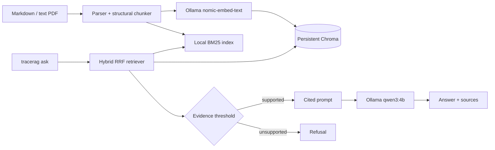

# TraceRAG

TraceRAG is a local-first, citation-first terminal RAG assistant. It indexes Markdown and text-layer PDFs, searches them with semantic and exact-term retrieval, and answers only when it can show supporting evidence.

## Quickstart

Requirements: Python 3.13, [uv](https://docs.astral.sh/uv/), and [Ollama](https://ollama.com/).

```bash
uv sync --extra dev
ollama pull nomic-embed-text
ollama pull qwen3:4b
uv run tracerag doctor
uv run tracerag corpus fetch fastapi
uv run tracerag ingest data/corpus/fastapi/docs/en/docs
uv run tracerag ask "How do path parameters work?"
```

The dependency lock is committed; use `uv sync --locked --extra dev` for a strict reproduction.

Answers show numbered citations and source previews. `--show-source 1` prints the complete cited chunk. Questions without evidence are refused before the generation model is called; `--show-nearest` is available for diagnosis.

The default evidence threshold (`0.72`) is calibrated for `nomic-embed-text` on the pinned FastAPI demo corpus. If you change embedding models or corpora, measure and tune `TRAGERAG_MIN_RETRIEVAL_SCORE` rather than assuming this value transfers unchanged.

## Optional Compose path

Native `uv` + Ollama is the primary setup. If Docker Desktop is running, the
optional stack persists Ollama models and TraceRAG data in named volumes:

```bash
docker compose up -d ollama
docker compose run --rm tracerag doctor
docker compose run --rm tracerag corpus fetch fastapi
docker compose run --rm tracerag ingest /app/data/corpus/fastapi/docs/en/docs
docker compose run --rm tracerag ask "What kind of web framework is FastAPI?"
```

The Compose app has no cloud inference default and does not replace the native
reproduction path.

## Architecture



Documents, embeddings, retrieval, and generation remain local by default. TraceRAG does not ship a web UI, agent loop, MCP server, OCR pipeline, or multi-user authorization in v1.

## Evaluation

The versioned 40-question FastAPI set lives at `evals/dataset/fastapi-v1.json`. Run it after fetching and ingesting the corpus:

```bash
uv run tracerag eval
```

For a quick smoke test, use `uv run tracerag eval --limit 1`. The full 40-case
gate is intentionally model- and hardware-dependent; it prints per-case
progress and writes `reports/latest.json` plus `reports/latest.md` only after
all requested cases finish.

Reports are written to `reports/latest.json` and `reports/latest.md`. The intended release gate is 100% citation validity, at least 90% retrieval recall@5, and at least 85% manually reviewed factuality. Failures remain visible rather than being hidden by an aggregate score.

The current measured snapshot is documented in [`docs/evaluation-report.md`](docs/evaluation-report.md); the committed regression baseline is [`evals/baseline/fastapi-v1.json`](evals/baseline/fastapi-v1.json). The deterministic factuality check is supplemented by the 35-answer semantic review in [`docs/manual-review.md`](docs/manual-review.md).

The reproducible terminal recording checklist is in [`docs/demo-script.md`](docs/demo-script.md),
and a captured native session is preserved in [`docs/demo-recording.txt`](docs/demo-recording.txt).

## Attribution

TraceRAG is an independent implementation informed by the architecture and public design of [n0nuser/LocalRAG](https://github.com/n0nuser/LocalRAG). LocalRAG is MIT-licensed; no source files are copied wholesale into this repository. The FastAPI demonstration corpus is fetched from the [FastAPI repository](https://github.com/fastapi/fastapi) at a pinned commit and remains subject to its MIT license.
