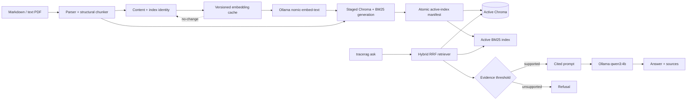

# TraceRAG

TraceRAG v1.1 is a local-first, citation-first terminal RAG assistant. It indexes
Markdown and text-layer PDFs, searches them with semantic and exact-term
retrieval, and answers only when it can show supporting evidence. The release
focuses on reliable incremental indexing, exact evidence targets, and measured
operator workflows on a compact Apple Silicon laptop.

## Quickstart

Requirements: Python 3.13, [uv](https://docs.astral.sh/uv/), and [Ollama](https://ollama.com/).

```bash
uv sync --locked --extra dev
ollama pull nomic-embed-text
ollama pull qwen3:4b
uv run tracerag doctor
uv run tracerag corpus fetch fastapi
uv run tracerag ingest data/corpus/fastapi/docs/en/docs
uv run tracerag ask "How do path parameters work?"
```

The dependency lock is committed; use `uv sync --locked --extra dev` for a strict reproduction.

The complete command surface is in [`docs/command-reference.md`](docs/command-reference.md).

Answers show numbered citations and source previews. `--show-source 1` prints the complete cited chunk. Questions without evidence are refused before the generation model is called; `--show-nearest` is available for diagnosis.

The default evidence threshold (`0.72`) is calibrated for `nomic-embed-text` on the pinned FastAPI demo corpus. If you change embedding models or corpora, measure and tune `TRAGERAG_MIN_RETRIEVAL_SCORE` rather than assuming this value transfers unchanged.

## Release evidence

Run the three-phase benchmark after fetching and ingesting FastAPI:

```bash
uv run tracerag benchmark --corpus fastapi --output-dir docs
```

It writes machine-readable JSON and reviewer-readable Markdown for clean ingest,
unchanged re-ingest, and a one-file edit. The committed snapshot is
[`docs/benchmark-fastapi.md`](docs/benchmark-fastapi.md), with the raw result in
[`docs/benchmark-fastapi.json`](docs/benchmark-fastapi.json). Timings are
reported for the captured machine and model tags; they are not universal
guarantees.

## Reproducible public corpora

TraceRAG ships two public corpus profiles. Each fetch checks out an immutable
commit, validates its allowlisted tree, and writes a `.tracerag-corpus.json`
manifest containing the source, license, commit, and discovered file count.

```bash
uv run tracerag corpus fetch fastapi
uv run tracerag corpus fetch clippy
```

The Clippy profile is limited to `book/src/development/**`; ingest the printed
allowlisted path rather than the repository root:

```bash
uv run tracerag ingest data/corpus/clippy/book/src/development
```

FastAPI is pinned to commit `f336ff831c4af3d4f625c2593a27b1e0cae93eb7` under
the MIT license. Clippy is pinned to commit
`d2c4d1532d89488a56ec2c3ca12757117fc0b4e2` under `MIT OR Apache-2.0`.

## Optional Compose path

Native `uv` + Ollama is the primary setup. If Docker Desktop is running, the
optional stack persists Ollama models and TraceRAG data in named volumes:

```bash
docker compose up -d ollama
docker compose run --rm tracerag doctor
docker compose run --rm tracerag corpus fetch fastapi
docker compose run --rm tracerag ingest /app/data/corpus/fastapi/docs/en/docs
docker compose run --rm tracerag ask "What kind of web framework is FastAPI?"
```

The Compose app has no cloud inference default and does not replace the native
reproduction path.

## Architecture



Documents, embeddings, retrieval, and generation remain local by default. A
single writer lock protects staged index activation; queries remain available
without taking that write lock. TraceRAG does not ship a web UI, agent loop, MCP
server, OCR pipeline, cloud inference path, or multi-user authorization in v1.1.

## Evaluation

The versioned 40-question FastAPI set lives at `evals/dataset/fastapi-v1.json`. Run it after fetching and ingesting the corpus:

```bash
uv run tracerag eval
```

The Clippy evaluation set lives at `evals/dataset/clippy-v1.json` and uses the
same exact relative-source-plus-heading evidence contract:

```bash
uv run tracerag eval --dataset clippy-v1
```

Evaluation reports record dataset and corpus pins, index/cache provenance, each
accepted retrieval target, the matched target and rank, and a failure class.

For a quick smoke test, use `uv run tracerag eval --limit 1`. The full 40-case
gate is intentionally model- and hardware-dependent; it prints per-case
progress and writes dataset-specific `reports/fastapi-v1.json` plus
`reports/fastapi-v1.md` only after all requested cases finish.

Reports are written to dataset-specific JSON and Markdown files. The intended
release gate is 100% citation validity, at least 90% retrieval recall@5, and at
least 85% manually reviewed factuality. Failures remain visible rather than
being hidden by an aggregate score.

The latest H5 capture meets the local release gates: FastAPI reached 100%
citation validity, 100% Recall@5, and 97.1% deterministic factuality; Clippy
reached 100% for all three metrics. FastAPI's one deterministic expected-fact
proxy miss is semantically supported and documented in the manual review.

The FastAPI evaluation procedure and smoke evidence are documented in
[`docs/evaluation-report.md`](docs/evaluation-report.md); the parallel Clippy
procedure is in [`docs/evaluation-report-clippy.md`](docs/evaluation-report-clippy.md).
The committed regression baseline is [`evals/baseline/fastapi-v1.json`](evals/baseline/fastapi-v1.json).
The deterministic factuality check is supplemented by the 35-answer FastAPI
semantic review in [`docs/manual-review-fastapi.md`](docs/manual-review-fastapi.md)
and the 12-answer Clippy review in [`docs/manual-review-clippy.md`](docs/manual-review-clippy.md).

The reproducible terminal recording checklist is in [`docs/demo-script.md`](docs/demo-script.md),
and a captured native session is preserved in [`docs/demo-recording.txt`](docs/demo-recording.txt).

## Limitations

- The default baseline is an Apple M1 MacBook Air with 8 GB unified memory,
  Ollama, `nomic-embed-text`, and `qwen3:4b`. CPU and memory pressure affect
  ingest and answer latency; the benchmark records the actual environment.
- Retrieval quality depends on the embedding model, generation model, corpus,
  parsing, and threshold. The checked-in evaluation sets are evidence, not a
  universal accuracy guarantee.
- PDF support is limited to text-layer PDFs. Scanned documents require OCR,
  which is intentionally outside v1.1.
- There is no hosted service, browser UI, authentication, multi-user tenancy,
  agent loop, MCP server, or automatic web crawling.

## Version history

See [`CHANGELOG.md`](CHANGELOG.md) for the v1.1.0 release notes and the
reliability contracts added on top of the original v1 workflow.

## Attribution

TraceRAG is an independent implementation informed by the architecture and public design of [n0nuser/LocalRAG](https://github.com/n0nuser/LocalRAG). LocalRAG is MIT-licensed; no source files are copied wholesale into this repository. The FastAPI demonstration corpus is fetched from the [FastAPI repository](https://github.com/fastapi/fastapi) at a pinned commit and remains subject to its MIT license. The Clippy demonstration corpus is fetched from [rust-lang/rust-clippy](https://github.com/rust-lang/rust-clippy) at its pinned commit and remains subject to its `MIT OR Apache-2.0` license.
